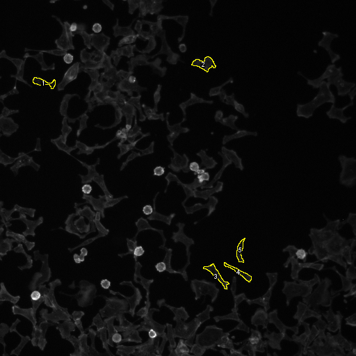
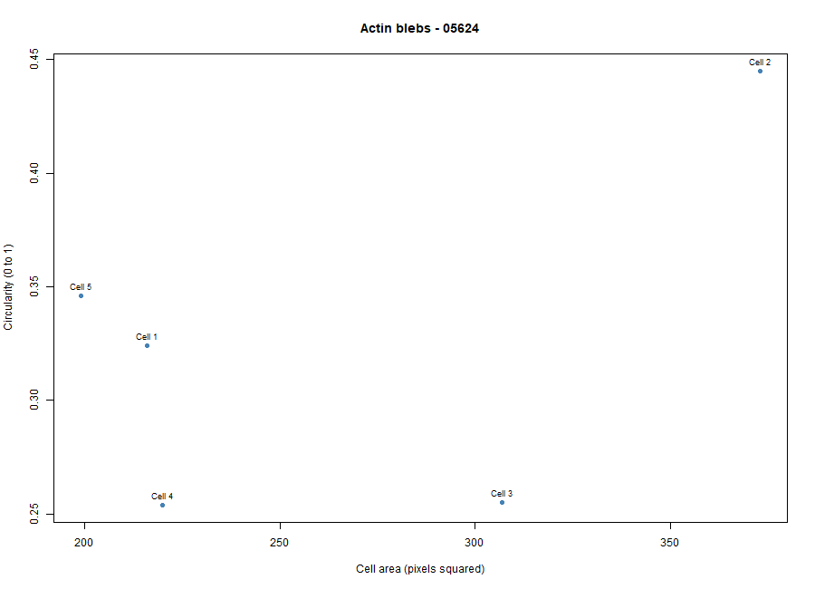
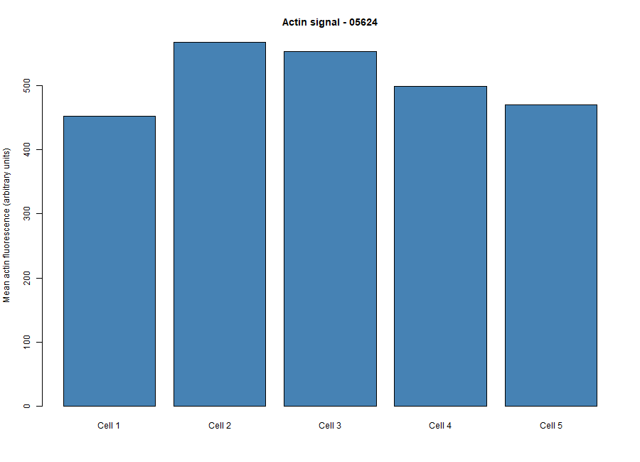

# Cytoskeleton and Cell Morphology Analysis
### BBBC018 Dataset | Karp Chapter 9: The Cytoskeleton and Cell Motility

## Student and Dataset Information

| Category | Details |
|---|---|
| Student ID | 202400712 |
| Dataset | BBBC018 – Human HT29 Colon-Cancer Cells |
| Selected Phenotype | Angular cell edges |
| Image-Field ID | 05624 |

---

## 1. Introduction

The cytoskeleton is an important component of the cell that provides structural support, maintains cell shape, and allows cells to change their morphology. One of its major components is actin, which forms filaments that help maintain the cell's structure and contribute to cellular movement.

This activity focused on examining F-actin distribution and cell morphology using fluorescence microscopy images of HT29 human colon-cancer cells from the BBBC018 dataset. The selected phenotype was **Angular cell edges**, which is characterized by cell outlines displaying noticeable corners, sharp turns, or angular boundaries.

Five cells from image field 05624 were selected for morphological analysis using Fiji/ImageJ. Their measurements were intended to examine cell area, circularity, aspect ratio, and mean actin fluorescence intensity. RStudio was then used to summarize the measurements and generate graphical representations of the results.

## 2. Dataset and Image Selection

The fluorescence images were obtained from the Broad Bioimage Benchmark Collection (BBBC018), which contains microscopy images of HT29 human colon-cancer cells displaying different cellular phenotypes.

**Dataset information:**

- Dataset: BBBC018
- Dataset source: [Broad Bioimage Benchmark Collection](https://bbbc.broadinstitute.org/BBBC018)
- Selected phenotype: Angular cell edges
- Image-field ID: 05624
- Actin filename: `05624-actin.DIB`
- DNA filename: `05624-DNA.DIB`

The actin channel was used to examine F-actin staining and identify cell boundaries. Meanwhile, the DNA channel served as a reference for locating nuclei and distinguishing neighboring cells.

## 3. Methodology

### 3.1 Image Examination and Cell Selection

The matching actin and DNA fluorescence images were opened in Fiji using Bio-Formats. The actin image was examined to identify cells displaying angular edges and clearly distinguishable boundaries.

Five suitable cells were selected for measurement. The Freehand Selection tool was used to trace their outlines, and each selected region was added to the ROI Manager.

### 3.2 Fiji Measurements

The measurement settings included Area, Mean gray value, Shape descriptors, and Display label under Set Measurements.

The selected cells were measured using Fiji/ImageJ. The resulting measurements included cell area, mean fluorescence intensity, circularity, and aspect ratio. The annotated fluorescence image showing the five selected cells was saved as:

`figures/measured_cells.png`

The measurement table was saved as:

`data/fiji_results.csv`

### 3.3 RStudio Analysis

The Fiji measurements were analyzed using an R script. The script was used to calculate the average cell area, circularity, aspect ratio, and mean actin fluorescence intensity.

Two graphical representations were generated:

1. A scatter plot showing cell area versus circularity.
2. A bar graph comparing the mean actin fluorescence intensity of the five measured cells.

The numerical summary was saved as `results/cell_summary.csv`, while the generated graphs were saved in the `figures/` directory.

## 4. Results and Discussion

The following figures and measurements will present the morphological characteristics and F-actin fluorescence intensity of the five selected HT29 cells from image field 05624.

### 4.1 Selected Cells and Their Boundaries

**Figure 1.** F-actin fluorescence image of HT29 cells from image field 05624, showing the five selected cells outlined using Fiji/ImageJ.

The selected cells were examined based on their visible angular boundaries. Their outlines were traced using the Freehand Selection tool, and the resulting regions of interest were recorded using the ROI Manager. These selections provided the measurements for the subsequent analysis.

### 4.2 Cell Area versus Circularity

**Figure 2.** Scatter plot showing the relationship between cell area and circularity among the five measured HT29 cells.

The scatter plot was generated to examine differences in cell size and shape. Cell area represents the size of each selected region, while circularity describes how closely its outline resembles a perfect circle. Lower circularity values indicate less circular or more irregular outlines.

The relationship between these measurements will help describe the morphological variation among the selected cells.

### 4.3 Mean Actin Fluorescence Intensity

**Figure 3.** Bar graph comparing the mean F-actin fluorescence intensity of the five selected HT29 cells from image field 05624.

The bar graph presents the mean actin fluorescence intensity measured within each selected region. Differences in the values indicate variation in the measured F-actin fluorescence signal among the cells.

These measurements describe the fluorescence intensity within the selected regions and do not directly measure the total amount of actin protein.

### 4.4 Summary of Cell Measurements

The following table will summarize the average measurements obtained from the five selected cells.

| Measurement | Mean Value |
|---|---:|
| Number of cells measured | 5 |
| Mean cell area | To be updated |
| Mean circularity | To be updated |
| Mean aspect ratio | To be updated |
| Mean actin fluorescence intensity | To be updated |

The final interpretation will be based on the completed Fiji measurements and RStudio analysis.

## 5. Guide Questions

### 1. Which specific phenotype did you choose, and what visible features support that choice?

The selected phenotype was **Angular cell edges**. This phenotype was identified based on the appearance of cell boundaries displaying noticeable corners, sharp turns, and angular outlines. These morphological features distinguish angular cell edges from cells with predominantly smooth or rounded boundaries.

### 2. Were your five cells mostly round or elongated? Refer to your circularity and aspect-ratio results.

The shape of the five selected cells will be evaluated using their mean circularity and aspect-ratio measurements. Circularity values closer to 1 indicate more rounded shapes, while lower values indicate less circular or irregular outlines. A higher aspect ratio generally indicates greater elongation.

The final description will be based on the actual measurements obtained from Fiji.

### 3. What role does actin play in maintaining cell shape and in cell movement?

Actin is an important component of the cytoskeleton that provides structural support and helps maintain cell shape. It also contributes to cell movement by forming structures such as lamellipodia and filopodia, which allow cells to extend their membranes. Through the continuous assembly and disassembly of actin filaments, cells can change their shape and move.

### 4. Why can a single fixed fluorescence image NOT show how fast a cell moves?

A single fixed fluorescence image captures the structure and appearance of cells at only one point in time. It does not show changes in cell position or shape over time. Therefore, cell movement speed cannot be determined from a single fixed image. Measuring movement requires observations at multiple time points, such as through live-cell imaging.

## 6. Conclusion

This activity examined the morphology and F-actin fluorescence of HT29 human colon-cancer cells using the BBBC018 dataset. The selected phenotype was Angular cell edges, which focuses on the appearance of angular or sharply defined cell boundaries.

Through Fiji/ImageJ and RStudio, the activity demonstrates how fluorescence microscopy and quantitative measurements can be used to examine cell area, circularity, aspect ratio, and actin fluorescence intensity. These measurements provide information about cellular morphology and the organization of the cytoskeleton.

The final conclusions regarding the five selected cells will be based on the completed measurements and graphical results.

## 7. Repository Organization

The repository contains the following folders and analysis outputs:

| Folder/File | Description |
|---|---|
| `data/` | Fiji measurement data |
| `scripts/` | R analysis script |
| `results/cell_summary.csv` | Summary of the five measured cells |
| `figures/measured_cells.png` | Annotated image of the selected cells |
| `figures/area_vs_circularity.png` | Scatter plot of cell area versus circularity |
| `figures/actin_intensity.png` | Bar graph of mean actin fluorescence intensity |

## 8. References and Data Sources

Broad Bioimage Benchmark Collection. (n.d.). *BBBC018: Human HT29 colon-cancer cells (diverse phenotypes).* Broad Institute. https://bbbc.broadinstitute.org/BBBC018

Ljosa, V., Sokolnicki, K. L., & Carpenter, A. E. (2012). Annotated high-throughput microscopy image sets for validation. *Nature Methods, 9*(7), 637. https://doi.org/10.1038/nmeth.2083

## 9. Data Credit and Image License

**Data Credit:** We used image set BBBC018v1 from the Broad Bioimage Benchmark Collection (Ljosa et al., 2012).

**Image License:** Creative Commons Attribution-NonCommercial-ShareAlike 3.0 (CC BY-NC-SA 3.0).
